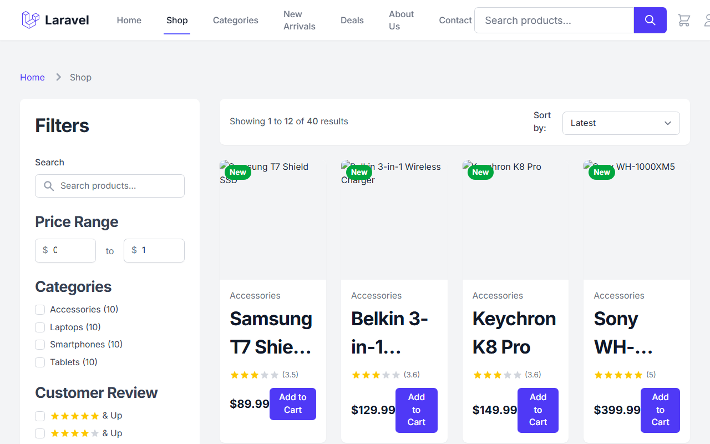
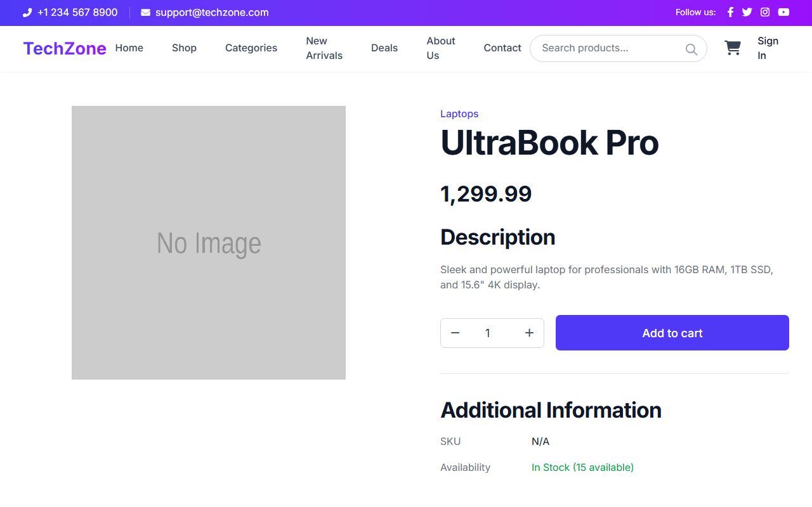
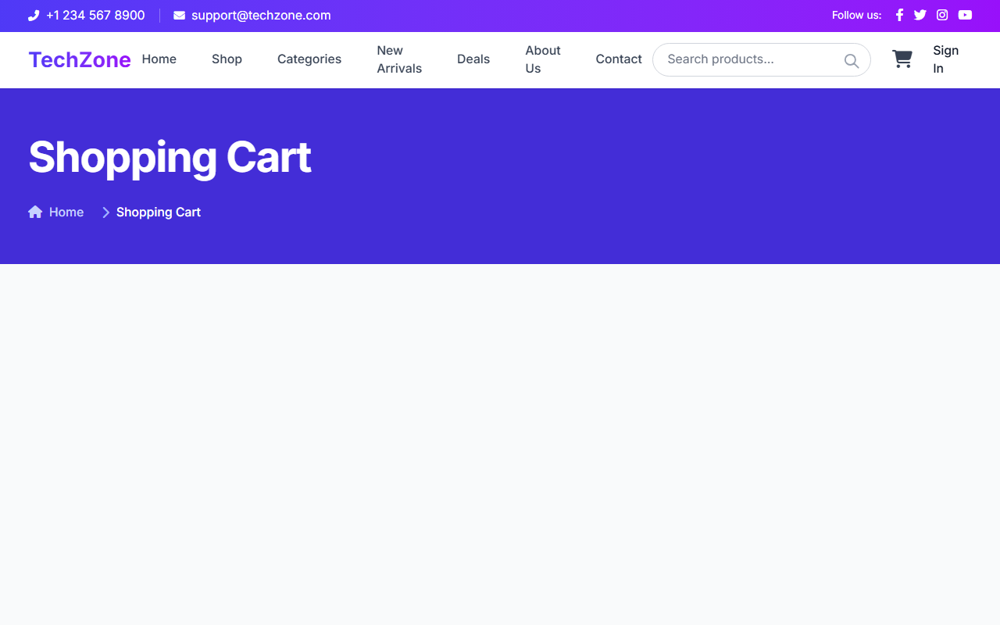
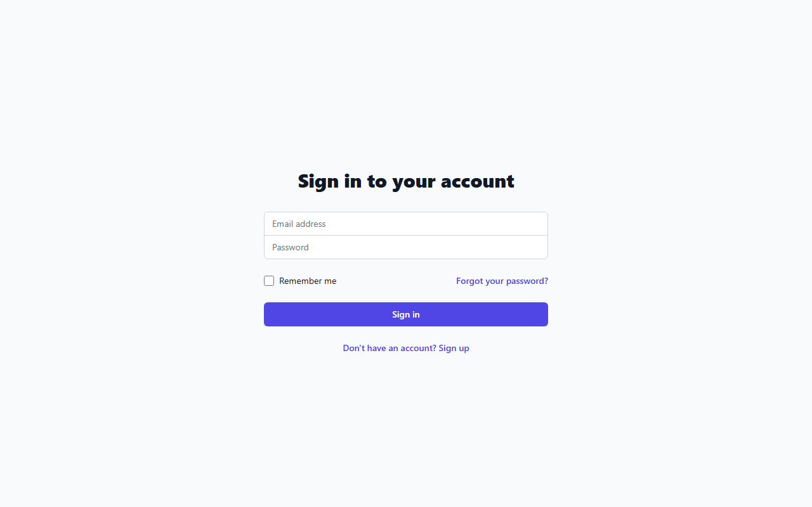
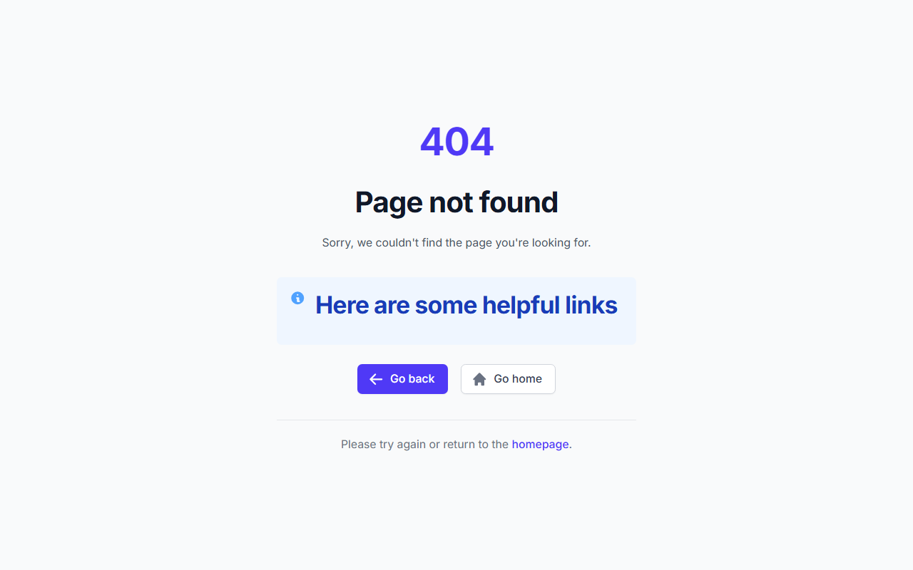

# Techzone — Modern E-Commerce Platform

[](https://github.com/aslamwebz/Techzone/actions/workflows/tests.yml)
[](https://www.php.net/)
[](https://laravel.com)
[](https://filamentphp.com)
[](https://tailwindcss.com)
[](LICENSE)

Techzone is a full-featured, secure e-commerce application built on **Laravel 13**, **Filament 5**, **Livewire 4**, and **Tailwind CSS 4**. Designed for electronics and hardware retail, it features real-time search and catalog filtering, an in-house session-backed cart engine, pessimistic stock locking at checkout, Google 2FA authentication, and back-office management.

---

## Screenshots

| Shop Catalog | Product Detail |
|:---:|:---:|
|  |  |

| Shopping Cart | Secure Checkout |
|:---:|:---:|
|  |  |

| Admin Management |
|:---:|
|  |

---

## Key Features

- **Product Catalog & Livewire Search:** Real-time search, price range filtering, category scoping, and rating filters with zero N+1 queries.
- **Native Cart Engine:** Session-backed `Cart` and `CartItem` services with calculated subtotals, configurable taxes, item metadata, and comprehensive unit tests.
- **Stock Checks & Transactions:** Atomic checkout execution within database transactions, utilizing pessimistic row locks (`lockForUpdate()`) to prevent race conditions and overselling.
- **Multi-Factor Security:**
  - Google Authenticator (TOTP) 2FA integration.
  - Rate limiting on authentication (`throttle:5,1`), checkout (`throttle:10,1`), and cart operations (`throttle:60,1`).
  - Spatie Honeypot anti-bot protection.
  - Granular authorization policies (`ProductPolicy`, `CategoryPolicy`, `UserPolicy`, `OrderPolicy`) and admin gates.
  - Dedicated Form Requests for input validation and strict mass-assignment protection.
  - Owen-It Eloquent audit trails and Sentry monitoring.
- **Administrative Portal:** Filament 5 & customized management interfaces for product inventory, category taxonomy, user roles, order statuses, and system audit logs.

---

## Tech Stack & Versions

- **PHP:** `~8.4.27 || ^8.5.12` (hardened against CVE-2026-109618 / CVE-2026-109619)
- **Framework:** Laravel `v13.38.0`
- **Admin Panel:** Filament `v5.10.3`
- **Frontend Interactivity:** Livewire `v4.4.8` & Volt `v1.11.2`
- **Design System:** Tailwind CSS `v4.3.3` with `@tailwindcss/postcss` & Vite `v6.3.5`
- **Authentication:** Laravel Breeze & Pragmarx Google2FA Laravel `v3.0.1`
- **Auditing & Telemetry:** Owen-It Laravel Auditing `v14.0.6` & Sentry Laravel `v4.29.0`
- **Anti-Spam:** Spatie Laravel Honeypot `v4.7.3`
- **Code Quality:** Laravel Pint & PHPUnit `v11.5.57`

---

## Getting Started

### Prerequisites

- PHP `^8.4` with extensions (`pdo_sqlite`, `curl`, `mbstring`, `zip`, `bcmath`, `fileinfo`)
- Composer `^2.7`
- Node.js `^20` & NPM

### Installation

1. **Clone the repository:**
   ```bash
   git clone https://github.com/aslamwebz/Techzone.git
   cd Techzone
   ```

2. **Install dependencies:**
   ```bash
   composer install
   npm install
   ```

3. **Configure environment:**
   ```bash
   cp .env.example .env
   php artisan key:generate
   ```

4. **Initialize database & demo fixtures:**
   ```bash
   php artisan migrate:fresh --seed
   ```

5. **Build assets:**
   ```bash
   npm run build
   ```

6. **Start local development server:**
   ```bash
   php artisan serve
   ```
   Visit `http://127.0.0.1:8000` in your browser.

---

## Demo Credentials (Local Development)

The database seeder provisions local demo accounts:

| Role | Email | Password | Access |
|---|---|---|---|
| **Admin** | `admin@example.com` | `password123` | Storefront, Admin Panel (`/admin`), Dashboard |
| **Customer** | `user@example.com` | `password123` | Storefront, Cart, Checkout, User Profile |

---

## Verification & Testing

Run the automated test suite and static analysis:

```bash
# Execute unit and feature tests (67 tests, 197 assertions)
php artisan test

# Verify code style standards
vendor/bin/pint --test

# Audit composer packages for security vulnerabilities
composer audit

# Build frontend production bundle
npm run build
```

---

## Continuous Integration

GitHub Actions executes `.github/workflows/tests.yml` on PHP 8.4 on every push and pull request:
- Automated `composer audit` vulnerability scanning.
- Style verification via `vendor/bin/pint --test`.
- Asset compilation via `npm run build`.
- Execution of the full PHPUnit test suite.
- Dependabot monitors weekly updates across Composer, NPM, and GitHub Actions.

---

## License

This software is open-sourced under the [MIT license](LICENSE).
